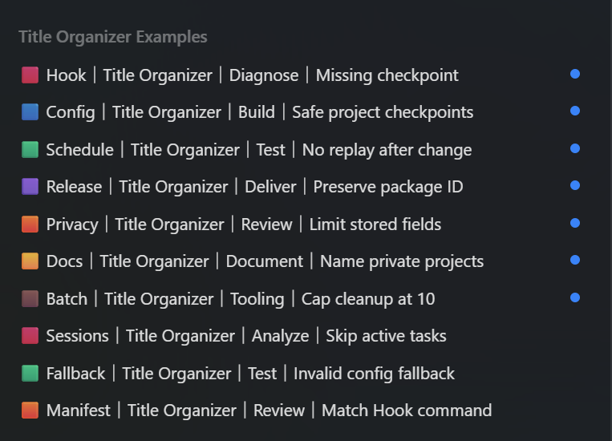
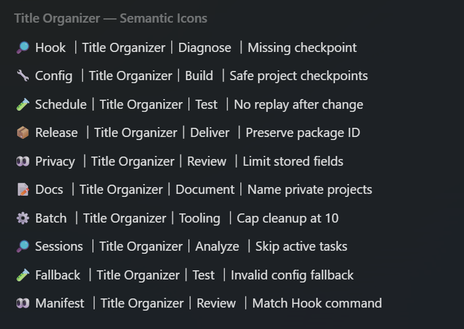

# Codex Task Title Organizer

A standalone Codex plugin for keeping task titles compact, searchable, visually
consistent, and tied to the right project or repository.

The plugin bundles one skill, a privacy-conscious `UserPromptSubmit` Hook, and
one narrowly matched `PostToolUse` observer:

- prompt 2 asks the active Codex turn to establish a useful title;
- prompt 4 refines it only when clearer task context is available;
- prompt 10 refreshes it only when the project, object, or purpose changed materially;
- the Hook never reads or persists prompt text;
- the observer records only that the current title tool completed after a
  checkpoint; it never reads the requested title or tool result;
- old tasks can still be normalized manually in batches of at most 10.

## Title standard

`Marker Domain｜Project/repository key｜Work type｜Concrete object: purpose or symptom`

Color blocks remain the default, while semantic icons and explicit custom
markers are supported:

| Primary outcome | Color blocks (default) | Semantic icons |
| --- | --- | --- |
| Analysis or diagnosis | `🟥` | `🔎` |
| Fix or implementation | `🟦` | `🔧` |
| Validation or testing | `🟩` | `🧪` |
| Delivery or synchronization | `🟪` | `📦` |
| Review | `🟧` | `👀` |
| Documentation or reporting | `🟨` | `📝` |
| Environment, tooling, or automation | `🟫` | `⚙️` |

Use exactly one leading marker. A project may define one custom marker or a
complete category mapping in `AGENTS.md`; explicit instructions for the current
operation take precedence. Invalid or incomplete custom mappings fall back to
color blocks at automatic checkpoints.

## Sidebar examples

Color blocks (default):



Semantic icons:



For private projects without Jira or Gerrit, the second field uses the project
name, repository name, or only the `cwd` basename. It never generates `NO-ID`.
A compact local activity date is the final fallback only when no project context
exists.

## How the Hook works

The command Hook does not rename a task by reaching into Codex internals. It
counts unique prompts, then adds a narrowly scoped developer instruction to the
same foreground turn. The active Codex turn uses the public current-task title
tool, without a thread ID, after finishing the user's main request.

State is stored under Codex's plugin data directory and contains only:

- a SHA-256 hash of the session ID in the filename;
- SHA-256 hashes of recently seen turn IDs and checkpoint turns awaiting the
  current foreground turn's title-tool completion;
- the prompt count, emitted checkpoints, and a bounded set of matching title-tool
  completion observations.

It stores no generated titles, prompt excerpts, transcripts, rollout data,
database content, full user paths, or project taxonomy.

`fired_thresholds` means only that the `UserPromptSubmit` Hook emitted checkpoint
context. A matching `PostToolUse` event is reported separately as **title tool
completion observed**. It is not evidence that a title changed, and a missing
completion is not recorded as an error: a `PostToolUse` Hook does not distinguish
no call, a failed call, an untrusted Hook, or an unsupported tool path. The
observer matches only `mcp__codex_app__set_thread_title` and never inspects its
input or response.

## Route renamed tasks to sidebar sections

Optional sidebar routing groups only successfully renamed **Codex tasks** by the
title's Domain field. It is disabled by default. When enabled, it reuses a
section named `🗂️ <Domain>` or, with an explicit allowlist, creates that section
and moves the same current task. It never routes ChatGPT conversations or turns
free-form project/object text into a section name.

Use a project-local configuration when one project needs this behavior:

```json
{
  "enabled": true,
  "checkpoints": [2, 4, 10],
  "sectionRouting": {
    "enabled": true,
    "sectionPrefix": "🗂️",
    "createMissingSections": true,
    "allowedDomains": ["Backend", "Mobile", "Infra"],
    "sectionDomainMap": {"Mobile": "Backend"},
    "maxSections": 12,
    "sectionCapacity": {
      "enabled": true,
      "maxItems": 10,
      "overflowDestination": "default"
    }
  }
}
```

The list is exact and bounded, so one malformed or overly specific title cannot
create unlimited sidebar sections. See the bundled
[`section-routing.md`](plugins/codex-task-title-organizer/skills/organize-codex-task-titles/references/section-routing.md)
for user-wide configuration, routing behavior, and batch limits.

`sectionDomainMap` is optional: it keeps a detailed Domain in the title while
routing it to one approved parent section.

`sectionCapacity` is separately opt-in. It keeps a routed section newest-first:
after a successful rename, the current task is moved to the top and the section
retains at most `maxItems` (10 by default). Confirmed Codex overflow tasks return
to the normal Tasks area through the safe `"default"` destination; they are not
deleted or archived. It never moves a ChatGPT conversation, re-reads the sidebar,
or stores sidebar IDs. See the bundled
[`section-routing.md`](plugins/codex-task-title-organizer/skills/organize-codex-task-titles/references/section-routing.md)
for the exact failure and ordering boundaries.

## Configure checkpoints

The default schedule is `2,4,10`. For one project, create
`.codex/task-title-organizer.json`:

    {
      "enabled": true,
      "checkpoints": [2, 4, 10]
    }

Set `"enabled": false` to disable the Hook for that project.

For a user-wide override, set `CODEX_TASK_TITLE_CHECKPOINTS` to a comma-separated
list such as `1,3,8`. The Hook also supports `PLUGIN_DATA/config.json` for managed
or advanced installs. Precedence is project file, environment variable,
plugin-data file, then defaults. Values must be 1-50, unique, with at most eight
checkpoints. Invalid configuration safely falls through to the next source.

Schedule changes do not replay checkpoint numbers that already passed in an
active task.

## Install from GitHub

```text
codex plugin marketplace add znbsf/codex-task-title-organizer --ref main
codex plugin add codex-task-title-organizer@codex-task-title-organizer
```

Restart or refresh Codex, open `/hooks`, inspect the exact `UserPromptSubmit` and
`PostToolUse` commands, and trust them.
Automatic checkpoints are not active until that user review is complete.

## Install from a local checkout or ZIP

```text
codex plugin marketplace add "<repository-root>"
codex plugin add codex-task-title-organizer@codex-task-title-organizer
```

Keep the local marketplace directory at a stable path. See [INSTALL.md](INSTALL.md)
for the full AI-oriented procedure and migration guidance.

## Manual use

The bundled skill remains available for explicit work:

```text
Use $organize-codex-task-titles to standardize the current Codex task title.
```

```text
Use $organize-codex-task-titles to normalize recent Codex task titles, changing
at most 10 and skipping active and ChatGPT tasks.
```

```text
Use $organize-codex-task-titles to normalize and route recent Codex task titles
into sidebar sections.
```

```text
Use $organize-codex-task-titles to migrate recent compliant titles to semantic
icons, changing only the leading marker.
```

## Develop and verify

Python 3.10 or newer is recommended. The Hook itself has no third-party runtime
dependencies.

```text
python -m compileall -q plugins/codex-task-title-organizer/scripts
python -m unittest discover -s tests -v
```

CI exercises both Windows and Linux because the state lock is platform-specific.

## Safety boundaries

- Current-task checkpoints never list or read other task content. The sole
  routing exception may read sidebar section metadata once after a successful
  title update; it uses no task content and moves only that returned current
  Codex task.
- Batch operations modify only `kind=codex`, skip active tasks by default, and
  stop at 10 changes per run.
- The plugin never uses Codex databases, session/rollout files, or UI automation
  as a title-management fallback.
- Installing the plugin does not create, edit, or delete recurring automations.
